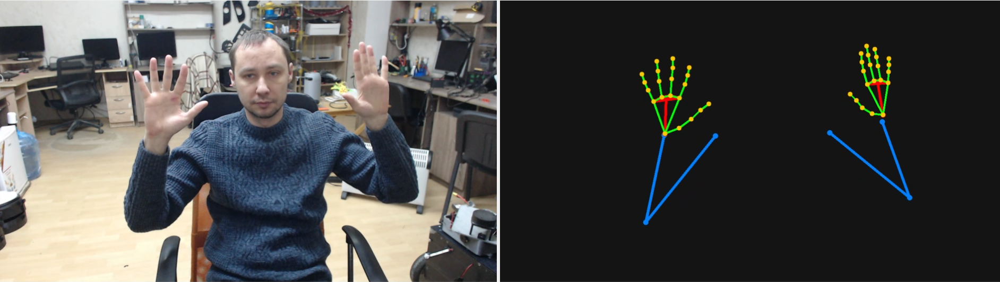

# HandTracking_Version_3

Real-time desktop application that shows a live camera feed and a skeleton
visualization with a square-like palm (quad) and arm (shoulder/elbow/wrist).

## Installation (Windows)
1. Install Python 3.10+ if you prefer a global install.
2. Or run the portable installer script:
   - `python requirements.py`

## Run the app
- If you used portable Python, run:
  - `.python311\python.exe main.py`
- If you used a venv:
  - `venv\Scripts\activate`
  - `python main.py`

## Version 3 features
- Palm drawn as a quad (index/middle/ring/pinky MCP) with wrist connected to its center
- Fingers attach to the palm quad, joints and bones drawn clearly
- Arms (shoulder/elbow/wrist) drawn from MediaPipe pose landmarks
- Two live frames: raw camera (left) and skeleton only (right)

## How it works
- The camera is opened with OpenCV and frames are read on a timer (~30 ms).
- Each frame is sent to MediaPipe Holistic, which outputs pose and hand landmarks.
- The left panel shows the raw camera frame with correct aspect ratio.
- The right panel draws only the skeleton on a dark background:
  - Palm is a quad using MCP joints (5, 9, 13, 17).
  - The wrist connects to the center of this quad.
  - Fingers are drawn as joint chains using MediaPipe hand connections.
  - Shoulder, elbow, and wrist are drawn from pose landmarks.
