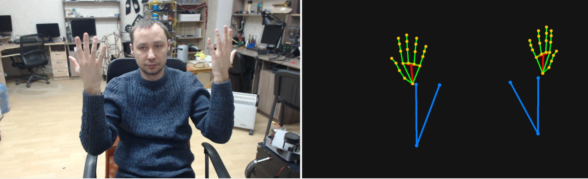
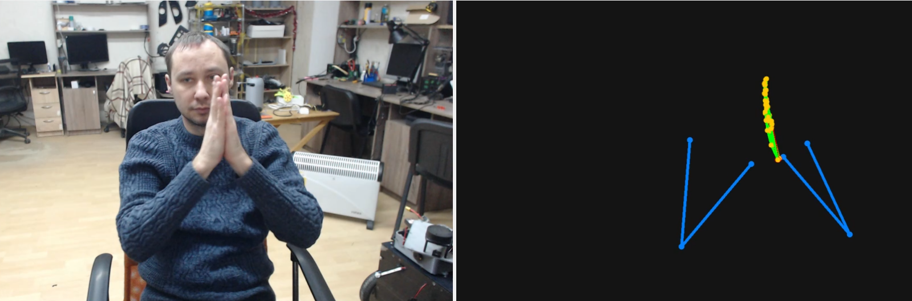

# HandTracking

A real-time Windows desktop application for hand, palm and arm tracking from a webcam, with a live camera view and a separate skeleton visualization.


[](https://www.youtube.com/watch?v=M0BCqlvyWic)

## Overview

HandTracking was developed by GEC Engineering as a practical desktop application around the **Google MediaPipe Holistic** computer-vision solution. MediaPipe provides the underlying pose and hand landmarks; this project adds the application layer around that vision core: camera discovery and switching, frame capture, the PySide6 user interface, the custom skeleton renderer (palm quad, finger chains, shoulder–elbow–wrist arm segments) and a portable Windows installer.

The project is not a fork of MediaPipe. It uses the public MediaPipe Python solution API (`mediapipe.solutions.holistic`) and implements its own application architecture and visualization around its outputs.

**Upstream computer-vision foundation:**  
[Google MediaPipe](https://github.com/google-ai-edge/mediapipe) — Apache License 2.0.

Typical uses: hand-gesture and teleoperation research, human–machine interaction prototypes, robotic-hand / manipulator control experiments, rehabilitation and motion-analysis demos.

## Demonstration

| Live camera + skeleton | Palm quad and finger joints | Arm tracking |
| --- | --- | --- |
|  |  |  |

A screen recording of the running application is included in [`content/video.mp4`](content/video.mp4) and on YouTube: https://www.youtube.com/watch?v=M0BCqlvyWic

## What the application does

- discovers available USB / integrated cameras (DirectShow) and lets the user switch between them;
- captures frames at 1280×720 where the camera supports it;
- runs MediaPipe Holistic locally on every frame (~30 ms timer);
- shows two synchronized panels:
  - **left** — the raw camera image with the correct aspect ratio;
  - **right** — the skeleton only, drawn on a dark background;
- draws the **palm as a quad** through the index, middle, ring and little-finger MCP joints (landmarks 5, 9, 13, 17) and connects the wrist to the centre of that quad;
- draws **finger bones and joints** for the left and right hands from the 21 MediaPipe hand landmarks;
- draws **both arms** (shoulder → elbow → wrist) from MediaPipe pose landmarks;
- start / stop of the stream without closing the application.

## How it works

1. `CameraManager` opens the selected camera with OpenCV and reads frames on a Qt timer.
2. `HolisticTracker` converts each frame to RGB and passes it to MediaPipe Holistic (`model_complexity=1`, landmark smoothing enabled).
3. `SkeletonDrawer` renders the pose arm segments, the palm quad, wrist-to-palm link, finger bones and joints onto an empty canvas.
4. `MainWindow` (PySide6) displays the raw frame and the skeleton side by side.

## Project structure

```text
HandTracking/
├── main.py                    # application: camera, MediaPipe tracker, skeleton renderer, GUI
├── requirements.txt           # pinned Python dependencies
├── requirements.py            # portable installer (embedded Python 3.11 + dependencies)
├── install_dependencies.bat   # venv-based installer
├── content/                   # screenshots and demo video
├── LICENSE                    # Apache License 2.0
├── NOTICE
└── THIRD_PARTY_LICENSES.md
```

## Installation (Windows)

Supported environment: Windows 10 / 11, 64-bit Python 3.10–3.11, USB or integrated webcam.

**Option A — virtual environment**

```bat
install_dependencies.bat
venv\Scripts\activate
python main.py
```

**Option B — portable Python (no global install)**

```bat
python requirements.py
.python311\python.exe main.py
```

`requirements.py` downloads the official embeddable Python 3.11 from python.org and installs the pinned packages into a local `.python311` folder.

## Dependencies

- PySide6 6.7.2
- OpenCV (`opencv-python`) 4.10
- MediaPipe 0.10.14
- NumPy 1.26

See `requirements.txt` for pinned versions.

## Local processing and privacy

All computer-vision inference runs locally. Camera frames are not sent to any cloud service by this application. Internet access is only needed during installation to download Python packages.

## License

The application source code in this repository is released under the **Apache License 2.0**. See [LICENSE](LICENSE).

Third-party components remain under their respective licenses:

- **MediaPipe** — Apache License 2.0;
- **OpenCV** — Apache License 2.0;
- **NumPy** — BSD-3-Clause;
- **PySide6 / Qt for Python** — LGPLv3 / GPLv3 / commercial licensing options.

See [THIRD_PARTY_LICENSES.md](THIRD_PARTY_LICENSES.md) and [NOTICE](NOTICE) for details.

## Attribution

Hand and pose landmark detection is provided by **Google MediaPipe** (Holistic solution). MediaPipe is a Google project and is not affiliated with this repository.

The custom code in this repository implements the desktop GUI, camera management, palm-quad and arm skeleton visualization and the Windows installation workflow.

## Author

**Lead Engineer, GEC Engineering — Oleg Gridin**

GEC Engineering develops computer-vision, robotics and electronics systems — from camera and sensor integration to embedded hardware and working prototypes.

- Website: https://gec-engineering.tech/
- GitHub: https://github.com/gridinwork
- YouTube: https://www.youtube.com/@GEC_Company

## Notes

This is a computer-vision prototype and engineering tool. Tracking quality depends on camera quality, lighting, occlusion, distance and hand pose.
